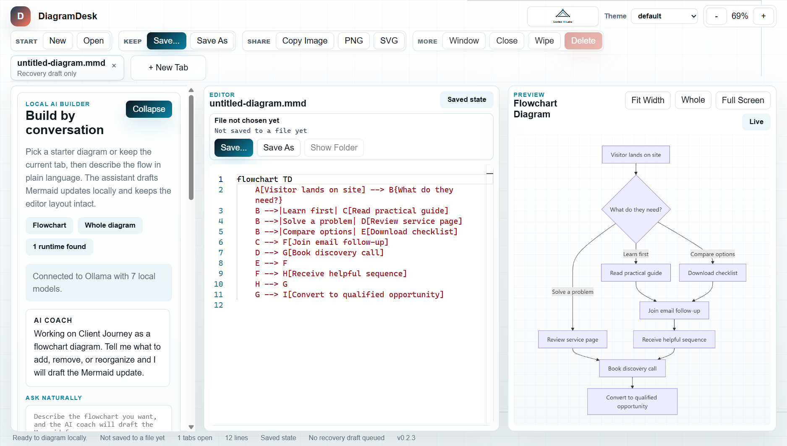
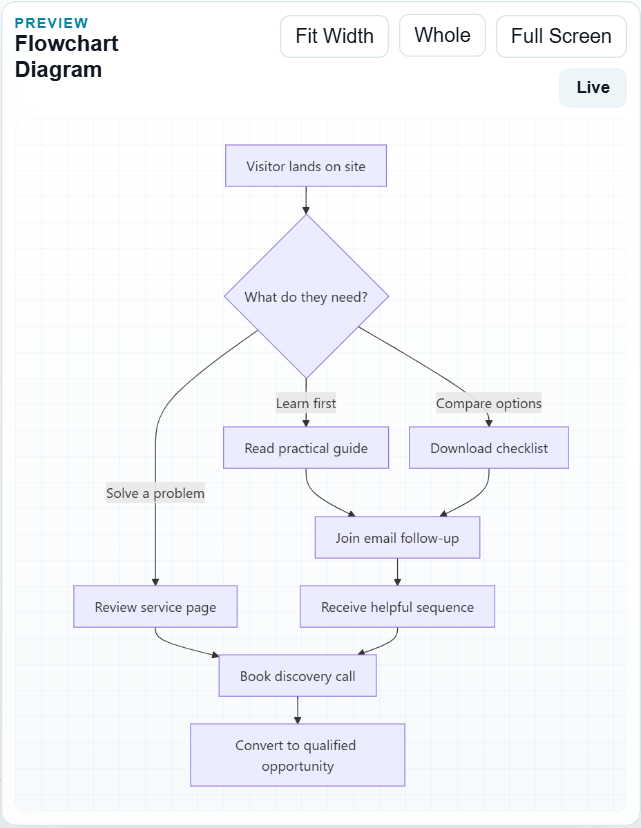
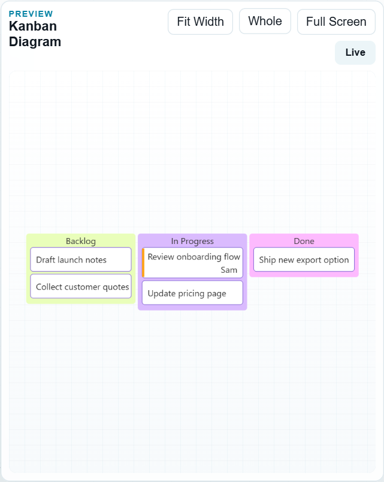

# Mermaid Tool

## Screenshots

**Editor with local AI builder**

**Live preview — rendered flowchart**

**Kanban diagram (Mermaid v11)**

## Purpose

Mermaid Tool is a Guided AI Labs local desktop Mermaid editor for people who want a simple, polished way to open `.mmd` files, edit diagrams, preview them live, and export clean SVG or PNG assets without relying on a hosted web editor.

It is built for amateur-friendly local use:

- open Mermaid files from disk
- keep several documents open at once with tabs inside each window
- open multiple Mermaid Tool windows for side-by-side work
- edit diagrams in a large Monaco-powered editor
- preview changes immediately with the official `mermaid` package
- open a collapsible AI builder rail on the left and shape diagrams through plain-language back and forth
- target local-only models served on the workstation, with no hosted AI dependency
- keep the diagram picker visible while the dialogue panel collapses upward inside the same sidebar
- pop the live preview into a fullscreen presentation view on demand
- drag the preview canvas with any mouse button to pan large diagrams
- zoom by scrolling over the canvas on Windows and Linux, or by pinching or Command+scrolling on a Mac, where two-finger scrolling pans
- fit oversized diagrams by width or whole-diagram view in preview and fullscreen
- use a tighter default flowchart layout so complex diagrams stay more compact and readable
- autosave in-progress drafts locally and recover them on restart
- autosave each open tab as its own local recovery draft
- save user files to a normal `Documents/Mermaid Tool` folder by default
- see whether a tab is only protected by recovery autosave or has a real saved file path
- reveal saved diagrams in the system file manager
- wipe the editor or delete the current saved file from inside the app
- export SVG and PNG locally
- install on Windows, macOS, or Linux, with `.mmd` and `.mermaid` files opening in the app

## Status

- Owner: Adam Goodwin
- Brand: Guided AI Labs
- Technical lead: codex session
- Risk tier: Medium
- Distribution: free through GitHub
- Production status: Local desktop app. See the platform table below for what has been tested on each system.
- Known issues: `docs/reviews/2026-11-06-functionality-and-tool-review.md`

## Supported Platforms

| Platform | Installer | Tested so far |
| --- | --- | --- |
| Windows 10 and 11, x64 | `.exe` setup | Tested on Windows 11. CI builds the installer, installs it, and smoke tests the result |
| macOS 13 or newer, Apple Silicon and Intel | `.dmg` and `.zip` | CI builds them, installs the Apple Silicon `.dmg`, and smoke tests the result. Not yet tried on a physical Mac, and the Intel build hasn't been run |
| Linux, x64 | `.AppImage` and `.deb` | CI builds both, installs each one, and smoke tests the result |

Mermaid Tool is free, so its installers aren't signed with a paid certificate. Windows SmartScreen and macOS Gatekeeper warn on first launch, and Windows Smart App Control may block the installer outright. See `docs/deployment-guide.md`.

## Quick Start

Requires Node.js 24 or newer. These commands work the same on Windows, macOS, and Linux.

1. Install dependencies with `npm install`
2. Build and launch with `npm run start`. The first launch downloads the Electron runtime.
3. If you want the AI builder, start any supported local runtime:
   - Ollama with at least one pulled chat model
   - LM Studio with its local server enabled
   - `llama.cpp` or another OpenAI-compatible local server

On Linux, you can also run `npm run install:desktop`, then launch from the desktop menu entry `Mermaid Tool` or with `bin/launch-mermaid-tool.sh`.

## Building Installers

Each command writes to `release/` and must run on the system it targets, because macOS installers can only be built on a Mac. CI builds all three when you push a branch under `installers/`.

| Command | Output |
| --- | --- |
| `npm run package:win` | `release/Mermaid-Tool-<version>-win-x64-setup.exe` |
| `npm run package:mac` | `release/Mermaid-Tool-<version>-mac-arm64.dmg`, `-x64.dmg`, and matching `.zip` files |
| `npm run package:linux` | `release/Mermaid Tool-<version>-x86_64.AppImage`, `release/Mermaid Tool-<version>-amd64.deb` |
| `npm run package:dir` | An unpacked app for the current system, for quick testing |

Packaging also requires Python 3 to generate the app icons.

## File Associations

- The Windows and macOS installers register `.mmd` and `.mermaid` so they can open in Mermaid Tool.
- On Linux, the `.deb` registers them system-wide, and `npm run install:desktop` registers them for the current user at `~/.local/share/applications/mermaid-tool.desktop`, pointing at this repo checkout.

## Validation Commands

- `bash scripts/governance-preflight.sh` (on Windows, run it from Git Bash)
- `npm run lint`
- `npm run test`
- `npm run build`
- `npm run test:smoke`, which needs a completed build and drives the real app with all remote hosts blocked
- `npm run secret-scan`

## Documentation

- `docs/architecture.md`
- `docs/manual.md`
- `docs/roadmap.md`
- `docs/deployment-guide.md`
- `docs/runbook.md`
- `docs/CHANGELOG.md`
- `docs/risks/risk-register.md`
- `docs/reviews/2026-11-06-functionality-and-tool-review.md`

## Support Model

This project is maintained as a local application. Operational support is currently owner-led. When behavior changes, update the docs and rerun the governance preflight before shipping additional features.
